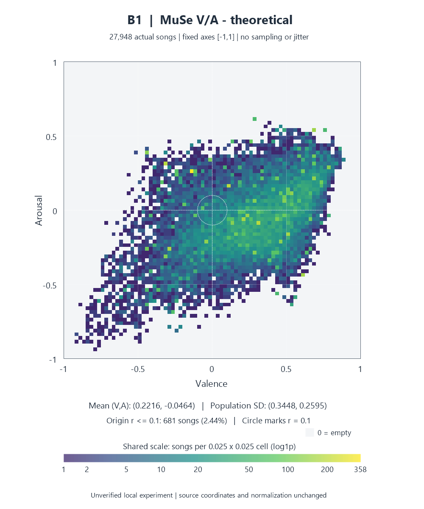

# 음악 DB 실험 결과 공유본

공통 27,948곡의 감정 좌표·추천 비교와 MuSe 선정 편향을 설명하는 **집계 발췌본**이다. 원본 5모델 실행을 다시 수행한 결과가 아니다. 원본·DB·체크포인트·기존 코드는 변경하지 않았다.

공유 범위는 MuSe의 B1/B2 집계와 모집단 비교로 한정했다. 개별 곡 좌표를 표시하는 산점도 및 ReccoBeats 좌표에 의존하는 A/C1/C2 수치·밀도는 제외했다. 따라서 이 폴더를 전체 5모델 결과 공개본으로 사용하면 안 된다.

| 주제 | 읽을 보고서 | 이미지 | 정밀 통계 |
|---|---|---|---|
| 추천 비교 | [B1/B2 비교](model-comparison-20261020/REPORT.md) | 좌표 분포 이미지와 함께 해석 | [조건](model-comparison-20261020/protocol.json), [결과 집계](model-comparison-20261020/result.json) |
| 좌표 분포 | [MuSe 분포](coordinate-distributions-20261020/REPORT.md) | [B1 밀도](coordinate-distributions-20261020/figures/density_B1.png), [B2 밀도](coordinate-distributions-20261020/figures/density_B2.png) | [분포](coordinate-distributions-20261020/statistics.json), [밀도·추천 연결](coordinate-distributions-20261020/density_vs_recommendation.json) |
| 선정·매칭 편향 | [모집단 비교](muse-selection-bias-20261020/REPORT.md) | [단계별 MuSe 밀도](muse-selection-bias-20261020/figures/matching_and_duplicates.png) | [흐름](muse-selection-bias-20261020/flow.json), [집합 통계](muse-selection-bias-20261020/statistics.json), [분포 차이](muse-selection-bias-20261020/contrasts.json) |

## 실험 목적과 핵심 결과

추천 비교는 동일 공통곡·동일 목표·동일 가중치/제외/Top-K에서 정규화의 영향을 비교한다. 목표는 {-1,-0.5,0,0.5,1}²의 25개, Top-20, V=A 가중치 1, 초기 반경 .05, 2배 확대다. 핵심 함수 기본 설정인 Top-100·초기 반경 .1과 구분한다.

| 모델 | 반경 .4 부족/빈 목표 | 전체 범위 평균 거리 | 평균 확대 | 평균 V/A |
|---|---|---:|---:|---|
| B1: MuSe 이론 정규화 | 8/7 | .27757 | 2.44 | .2216/−.0464 |
| B2: MuSe 전체 관측 정규화 | 4/4 | .20073 | 2.04 | .2772/.1681 |

전체 범위에서는 두 모델 모두 전 목표에서 20곡을 확보했다. B1–B2 평균 Top-20 중복률은 36.0%다. B1 빈 목표 7개·B2 빈 목표 4개는 전체 MuSe에서도 반경 .4 주변에 원본행이 없었다.

MuSe 전체 90,408행 → ID 보유 61,902행 → 고유 ID 60,741개 → 공통곡 27,948개를 구분했다. 전체→공통 raw 평균은 V 5.45388→5.49709, A 4.31720→4.29112이며, 표준화 평균 차이는 +.02783/−.02246이다. 전역 이동은 작지만 세부 밀도 차이는 남는다. 중복 1,063그룹은 대표곡으로 병합하지 않았고, ID 균등 가중 민감도는 확정된 고유곡 분포와 구분했다.

## 검증 범위와 해석 한계

- 작은 거리·낮은 부족률은 감정 정확도나 실제 음악 선호의 우열을 입증하지 않는다. 청취 평가는 미수행이다.
- 25개 목표 중 16개가 경계인 격자이며 실제 이용자 분포를 대표하지 않는다. 전체 MuSe도 전체 음악 카탈로그를 대표한다고 가정하지 않는다.
- 각 집합에 동일한 기존 정규화를 적용했다. 부분집합별 min/max 재계산은 없다. 히트맵은 bin 집계이며 산점도·곡 ID·좌표 행을 제공하지 않는다.
- 원본 검증 기록의 `original_run_result`와 5모델 카운터는 과거 실행 이력이다. 이번에는 자료 정제·파일 검사만 수행했다. 모델/DB 테스트는 재실행하지 않았다.
- 정제된 사본은 원본과 바이트가 다르다. [manifest.json](manifest.json)의 `source_sha256`와 `shared_sha256`를 구분한다. 패키지 검사는 [verification.json](verification.json)에 있다.

## 설치·코드·공개 범위

[REPRODUCING.md](REPRODUCING.md)에 코드만으로 가능한 설치·컴파일·합성 테스트와 비공개 데이터가 필요한 검증을 나눠 기록했다. [추천 핵심](../algorithm/recommend.ts), [SQL](../db/001_schema.sql), [서비스 준비 모듈](../integration/service.ts)은 기존 위치를 유지한다.

[SOURCES.md](SOURCES.md)는 MuSe 출처·기록된 라이선스·변경 표시를, [SHARING-REVIEW.md](SHARING-REVIEW.md)는 후보 36개 각각의 채택/정제/제외 이유를 설명한다. 외부 원본·오디오·원본 API 응답에 대한 공개 허가를 이 폴더로 추정하면 안 된다.

PROJECT/SPEC/PLAN/STATUS 및 관련 README의 실제 곡 식별정보·좌표와 공개 보류 실측 수치를 문서에서 정리했다. 구현과 로컬 연구 결과는 변경하지 않았다. 정제 범위와 기존 단계 설명의 구분은 [문서 점검](SHARING-REVIEW.md#기존-문서-변경-필요성)에 기록했다.
