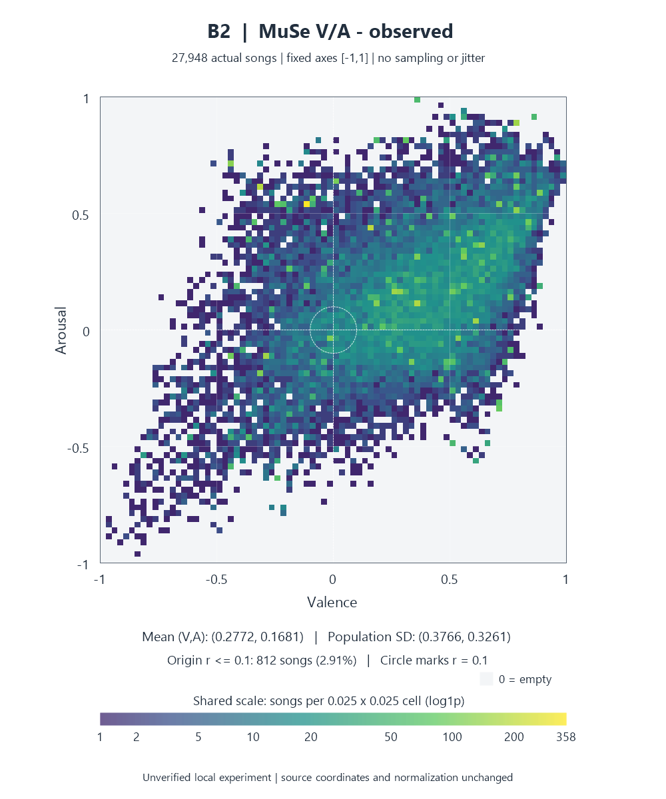

# MuSe B1/B2 좌표 분포 — 공유용 집계

> 공유용 발췌 사본. 개별 곡·Spotify ID·원본 API 응답은 포함하지 않는다. ReccoBeats 좌표에 의존하는 A/C1/C2 수치는 공개 조건 확인 전 보류했다. 원본은 비공개 로컬 폴더에 그대로 보존했다.

27,948개 동일 공통곡에서 MuSe의 이론(B1)·전체 관측 범위(B2) 정규화만 발췌했다. 원본 산점도는 개별 좌표를 표시하므로 공유하지 않고, 80×80 bin 집계 밀도 PNG 2개만 포함했다. [통계](statistics.json), [목표 주변 밀도/추천 연결](density_vs_recommendation.json).

| 모델 | 평균 V/A | 모집단 SD V/A | 원점 반경 ≤.1 | 빈 bin |
|---|---|---|---:|
| B1 | 0.2216/-0.0464 | 0.3448/0.2595 | 2.44% | 65.38% |
| B2 | 0.2772/0.1681 | 0.3766/0.3261 | 2.91% | 56.03% |

| 모델 | -- 곡수 | -+ 곡수 | +- 곡수 | ++ 곡수 |
|---|---:|---:|---:|---:|
| B1 | 5169 | 2494 | 10836 | 9449 |
| B2 | 3736 | 3350 | 4893 | 15969 |

모든 축 [-1,1], 정사각형·동일 축척·동일 log1p 곡수 색 척도다. bin 폭은 .025다. 각 bin의 집계이며 점별 좌표·곡 ID/곡명·개별 표를 제공하지 않는다. B1/B2 원본 PNG는 수정하지 않고 복사했으며 출처는 [SOURCES](../SOURCES.md)에 있다.

B1의 집중과 빈 경계는 반경 .4 부족 8개와 연결되며 B2는 4개다. 같은 원본에 대한 축척/원점 차이가 분포와 거리를 바꾼다. 밀도·짧은 거리로 감정 정확도나 선호 우위를 주장할 수 없다. bin 공백은 bin 폭에 의존하는 기술 통계다.

input/render/verification JSON은 원본 실행 검증에서 공유 가능한 메타데이터만 남겼다. 원본 5모델 카운터·검사 기록과 현재 B1/B2 공유 범위를 혼동하지 않는다. [재현 안내](../REPRODUCING.md).
