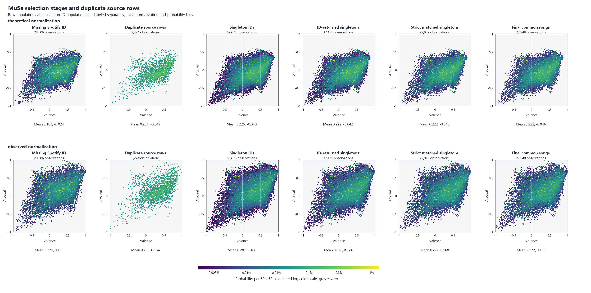

# MuSe 선정·매칭 편향 — 공유용 집계

> 원본 분석 보고서를 집계 중심으로 발췌했다. 좌표/ID 원본·중복 그룹 상세·점별 산점도·소수 집단의 감정 통계는 포함하지 않는다.

## 선정 흐름·단위

전체 MuSe 90,408행 → Spotify ID 보유 61,902행 → 고유 ID 60,741개 → 공통 실험곡 27,948곡이다. 단일행 ID는 59,678개다. 중복 1,063그룹/2,224행 중 V/A 충돌 965그룹은 임의 병합·평균 대표좌표 없이 보류했다. [flow.json](flow.json).

60,741 ID의 단일 좌표 분포는 중복 때문에 확정되지 않는다. ID 균등 가중 민감도는 각 원본행에 1/그룹행수의 가중치를 주며, 새 평균 곡을 생성한 분포가 아니다. 행 단위·단일행 곡 단위·가중 민감도를 구분한다.

## 고정 정규화·통계

이론 V/A [0,9], 전체 관측 V=[0.23500000000000001,8.475], A=[0.1081132075471698,7.27]에서 2*(raw-min)/(max-min)-1을 동일 적용했다. 부분집합별 재정규화는 없다. 표준편차는 모집단, 분위수는 가중 경험 CDF 역함수다. [method.json](method.json).

| 집합 | 관측 수/가중 질량 | raw 평균 V/A | raw SD V/A |
|---|---|---|---|
| all_rows | 90,408/90,408 | 5.45388/4.31720 | 1.55298/1.15465 |
| id_rows | 61,902/61,902 | 5.51376/4.28294 | 1.54654/1.16242 |
| id_balanced | 61,902/60,741 | 5.51289/4.28307 | 1.54802/1.16436 |
| common | 27,948/27,948 | 5.49709/4.29112 | 1.55178/1.16782 |

전체→공통 SMD는 V +0.02783/A −0.02246, KS는 .01702/.02459다. 사분면 비율 최대 차이는 이론 1.038%p·관측 1.668%p로 전역 위치 이동은 작지만 국소 밀도 차이가 남는다. 전체→공통 TV는 20/40/80-bin 이론 .0599/.0808/.1204, 관측 .0655/.0875/.1338이다. 표본 크기·bin 폭에 의존하므로 편향된 곡의 비율로 읽지 않는다.

ID 보유 단계에서 이동한 평균의 일부를 이후 매칭이 반대 방향으로 상쇄했다. 고유 ID 기준과 행 기준의 차이도 별도 계산했다. [statistics.json](statistics.json), [contrasts.json](contrasts.json)에 공유 가능한 집계/비교를 유지했다.

이 그림은 원본 MuSe의 80×80 bin 확률 집계다. 이미지의 strict 집단도 대규모 집단이며 점별 좌표는 표시하지 않는다. 단일행 탈락의 감정값을 직접 보여주거나 역산하기 쉬운 feature_missing/strict 집단 수치와 해당 차분 비교는 JSON 사본에서 제외했다. 이 그림은 그리드 집계이며 개별 좌표의 재배포본이 아니다.

## 통계·추천 해석의 한계

전체 관측 모집단 내부의 중첩 집합 비교다. 독립 두 표본 p값을 붙이지 않았고 단순무작위 비복원 추출의 해석적 기준값은 실제 선정 설계의 유의확률·인과 효과가 아니다. 공통곡 비교는 해당 집합에 조건부이며 전체 음악 카탈로그의 대표성을 보장하지 않는다.

B1 빈 목표 7개와 B2 빈 목표 4개는 전체 MuSe에서도 반경 .4 안에 원본행이 없었다. 주요 경계 공백은 최종 매칭 이전부터 존재했다. 정규화의 축척/원점 변화와 선정 효과를 구분해야 한다. 목표 주변 비율은 [target_density_connection.json](target_density_connection.json), B1/B2 기존 결과는 [recommendation_connection.json](recommendation_connection.json)에 있다.

## 공유본에서 제외한 내용

feature_missing(1행), strict_singletons/strict_rows의 감정 통계, strict 단계 차분 비교 2개, 모든 개별 ID/중복 원본, 원본 좌표 payload와 점별 산점도는 제공하지 않는다. 원본 통계·정규화·알고리즘·DB는 변경하지 않았다. result/verification/render/visual-qa는 원본 실행의 검증 이력을 정제한 사본이며 새 모델 검증을 수행했다는 뜻이 아니다.

[출처](../SOURCES.md) · [36개 후보 판정](../SHARING-REVIEW.md) · [재현/비공개 입력](../REPRODUCING.md)
